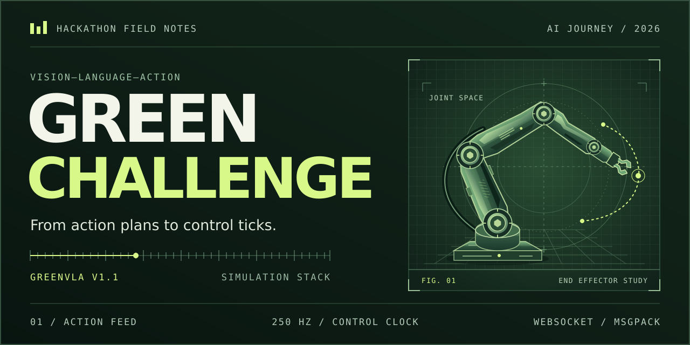
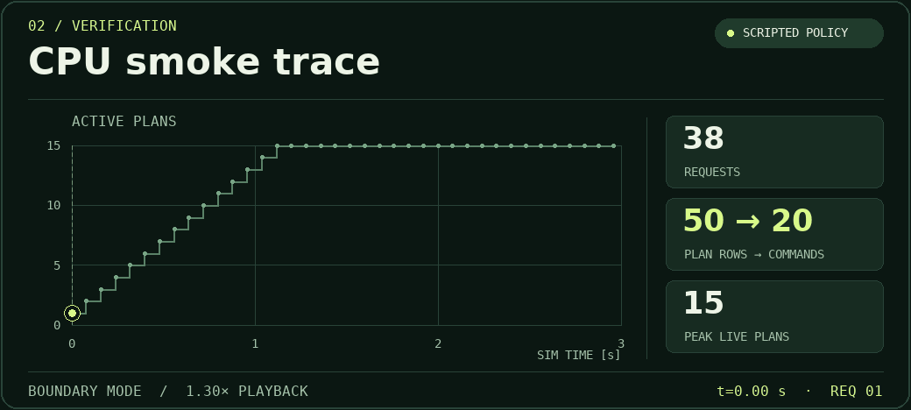

<a href="#инженерный-кейс"></a>

# От плана модели к командам робота

Проект участника хакатона [Green Challenge 2026](https://dsworks.ru/en/champ/aij26-green) на AI Journey. **GreenVLA предсказывает, что делать дальше; слой исполнения решает, когда отправить каждую команду.** В основе — чекпоинт организаторов, без переобучения. Вклад проекта — управление таймингом, адаптер протокола и стенд для проверки без GPU.

[Инженерный кейс](#инженерный-кейс) · [Запуск на CPU](#запуск-на-cpu) · [Документация](#документация) · [English](docs/portfolio/overview.en.md)

## Инженерный кейс

GreenVLA получает состояние робота, кадры с камер и текст подзадачи. Модель возвращает **план из 50 строк**, а симулятор каждые **80 мс** ждёт **20 команд** с шагом **4 мс** (250 Гц). Последовательные планы перекрываются: для одного такта они могут предсказывать разные действия. Если просто брать первые 20 строк нового плана, их время не совпадёт с тактами симулятора.

- **Исполнение.** [Action feed](greenchallenge/feed.py) привязывает строки плана ко времени наблюдения, интерполирует их, смешивает прогнозы с большим весом у свежих и ограничивает скорость и ускорение выбранных суставов. Просроченные планы можно исключить из смешивания, чтобы их последняя поза не тянула команду назад.
- **Протокол.** [Адаптер WebSocket/msgpack](greenchallenge/boundary.py) согласует раскладки состояния и команд. Например, симулятор может вернуть прошлую команду вместо измеренной позы — перед новым запросом к модели адаптер восстанавливает абсолютные углы пальцев.
- **Проверка изменений.** [CPU-стенд](tools/smoke_test.py) проверяет оба WebSocket-соединения с тестовой политикой. В [JSONL-телеметрии](greenchallenge/metrics.py) видны число активных планов и параметры исполнения; [отчёт по `results.json`](eval/) сравнивает очки и завершённые подзадачи по сценариям.

| Режим | Что происходит между симулятором и моделью |
| --- | --- |
| `GC_STACK=official` · по умолчанию | `serve_tracking` → `serve_policy` со штатным фидом организаторов. `GC_SPEED=1.3` меняет интервал между строками с 33,33 до 25,64 мс, не меняя веса модели или частоту запросов. |
| `GC_STACK=boundary` · стенд для экспериментов | Наш WebSocket-адаптер и action feed → `serve_policy` без штатного фида. Здесь проверяются отбрасывание устаревших планов и адаптивный темп (по умолчанию выключен). |

### Откуда взялось 1,3×

[Другой участник опубликовал сравнение](https://github.com/fanot/miniature-dollop/blob/9365c5b0a6997fe650e8df02c3eaae25ec8243c4/README.md#результаты-на-лидерборде): **15,445 → 18,096** балла (около **+17 %**) с тем же чекпоинтом при ускорении плана в 1,3 раза. Это причина выбрать такой дефолт, **не результат этого репозитория**. По сумме баллов нельзя отделить эффект темпа от изменения числа выполненных подзадач. См. [источники и оговорки](docs/FINDINGS.md).

## Запуск на CPU

<a href="docs/portfolio/README.md"><picture>
  <source media="(prefers-reduced-motion: reduce)" srcset="assets/portfolio/cpu-trace.png">
  
</picture></a>

*График из реальной телеметрии smoke-теста, не запись симулятора: тестовый клиент и тестовая политика обмениваются данными через настоящий адаптер и action feed. [Статичный кадр](assets/portfolio/cpu-trace.png) · [Как построен график](docs/portfolio/README.md).*

Python 3.10+ и shell. Не нужны Docker, CUDA, веса модели или Isaac Sim.

```bash
git clone --depth 1 https://github.com/overbaffe1/Green-Challenge.git
cd Green-Challenge
python3 -m venv .venv
. .venv/bin/activate
python -m pip install -r requirements-dev.txt
python -m pytest -q
python tools/smoke_test.py --speed 1.3 --seconds 3
```

В этом прогоне — **38 запросов** к адаптеру и столько же вызовов тестовой политики. Каждый ответ содержит **20 команд**, в смешивании одновременно участвует до **15 планов**. Это проверка транспорта и планирования, а не качества захватов. Запуск настоящего чекпоинта на GPU и итоговый скор в GreenSim здесь не подтверждены.

## Документация

| Задача | Куда идти |
| --- | --- |
| Проследить запрос от симулятора до модели и обратно | [Архитектура и тайминг](docs/ARCHITECTURE.md) · [Конфигурация](docs/CONFIGURATION.md) |
| Собрать конкурсный Docker-образ на GPU-хосте | [Команды с нуля](docs/COMMANDS.md) · [Runbook](docs/RUNBOOK.md) · [Доступ к реестру](docs/BUILD_IMAGE.md) |
| Воспроизвести A/B и разобрать очки | [Протокол оценки](docs/EVALUATION.md) · [Заметки по экспериментам](docs/FINDINGS.md) · [Модель счёта](docs/SCORE.md) |
| Проверить ограничения конкурса и формат отправки | [Правила](docs/COMPLIANCE.md) · [Формат](docs/SUBMISSION.md) · [Файл отправки](submission/) |

<details>
<summary>Дополнительные материалы</summary>

- [План дообучения](docs/TRAINING.md) и [валидатор датасета](training/) — рецепт, не заявка на обученный чекпоинт.
- [Заметки об артефактах](docs/ARTIFACTS.md) — отдельная судейская фикстура, не модель Green Challenge.

</details>

**Бейзлайн и симулятор:** [GreenVLA](https://github.com/greenvla/GreenVLA) и [GreenSim](https://github.com/greenvla/GreenSim) от организаторов. Код проекта заявлен под MIT в [`pyproject.toml`](pyproject.toml); веса и ассеты симулятора не входят в этот исходный код и имеют свои условия использования.
