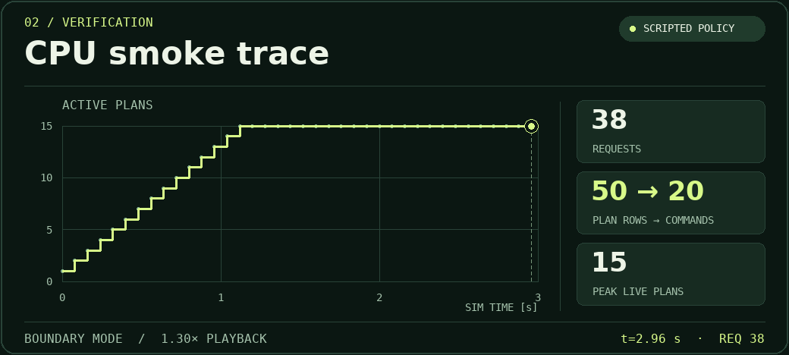

[← К кейсу Green Challenge](../../README.md) · [Пульт, A/B и STL](exhibition.md) · [English overview](overview.en.md)

# Телеметрия CPU-стенда



В [smoke-тесте](../../tools/smoke_test.py) тестовый клиент обращается к реальному WebSocket-адаптеру, а тот — к тестовой политике через второе WebSocket-соединение. Политика выдаёт детерминированный план, из которого action feed формирует поток команд. GPU и симулятор не запускаются.

Каждая точка — значение `live` из JSONL на запросе с симуляционным временем `t`. На запросе с `t = 1,12 с` бленд достигает 15 активных планов и держит этот уровень до конца прогона. Курсор в [GIF](../../assets/portfolio/cpu-trace.gif) проходит по данным один раз; неподвижный график доступен и без анимации. Скорость выполнения на CPU график не измеряет.

## Воспроизвести график

Из корня репозитория, после [установки dev-зависимостей](../../README.md#запуск-на-cpu). Для экспорта нужен Pillow и шрифт DejaVu Sans (пакет `fonts-dejavu-core` на Debian/Ubuntu; на других системах передай каталог через `--font-dir`).

```bash
python -m pip install Pillow
trace=$(mktemp)
python tools/smoke_test.py --speed 1.3 --seconds 3 --telemetry "$trace"
python assets/portfolio/render_trace.py "$trace"
rm "$trace"
```

`--telemetry` дописывает данные, поэтому для каждого прогона нужен новый файл. [Скрипт экспорта](../../assets/portfolio/render_trace.py) использует только симуляционное время, число планов и параметры запросов, а не меняющиеся от запуска к запуску задержки.

## Обложка

[Исходник SVG](../../assets/portfolio/cover.svg) — иллюстрация, а не кадр из GreenSim. [PNG 1280 × 640](../../assets/portfolio/social-preview.png) подготовлен из того же SVG для карточки ссылки. Чтобы применить его на GitHub, загрузи PNG в **Settings → Social preview**.
