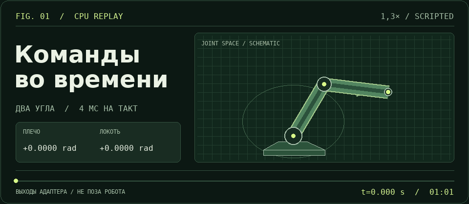
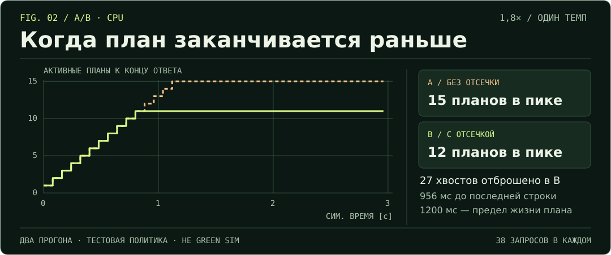
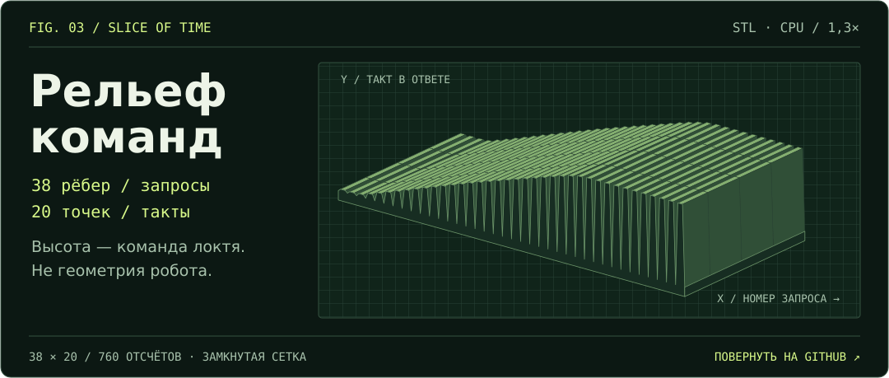

[← Витрина Green Challenge](../../README.md#витрина) · [Engineering overview](overview.en.md)

# Полевые приборы Green Challenge

Один тестовый клиент, настоящий слой исполнения и тестовая политика за вторым WebSocket-соединением. На этом стенде можно увидеть **что и в какой момент отправил сервер**, не подменяя CPU-проверку запуском GreenVLA или оценкой в GreenSim.

## 01 · Пульт исполнения

**[Скачать автономный пульт (ZIP)](../../assets/portfolio/control-room.zip?raw=true).** Распакуй архив и открой `green-control-room/index.html` в браузере. Интернет, Python и GPU для просмотра не нужны. Открывай из распакованной папки: рядом с HTML лежат стили, код и сами данные.

<a href="../../assets/portfolio/arm-replay.png"><picture>
  <source media="(prefers-reduced-motion: reduce)" srcset="../../assets/portfolio/arm-replay.png">
  
</picture></a>

1. **Пуск** проигрывает запись в половинном темпе. Ползунок или **−1 / +1** выбирает один такт в 4 мс; клик по графику перематывает туда же. Две координаты на схеме — выходные команды плеча и локтя. Геометрия условная, не из GreenSim.
2. **1,0× / 1,3× / 1,8×** — это четыре отдельных CPU-записи (у 1,8× два варианта отсечки). Браузер не запускает модель и не пересчитывает новые траектории. **Наложить A/B** сравнивает соседнюю запись на той же временной оси.
3. **Тайминг** показывает 50 моментов `lead + (i+1) × row_step` для очередного плана и отдельную лупу на первые 80 мс. Выбери один из 20 тактов, чтобы менять положение внутри того же ответа.
4. **Контракт 51 → 50 → 51** подсвечивает канал в трёх раскладках. Нажми «Запястье», затем «Yaw основания»: у второго есть место в `raw51`, но нет индекса в `model50`. Карта берёт перестановки из [`layout.py`](../../greenchallenge/layout.py), а не рисует их вручную.

[Исходники пульта](../control-room/) · [Записанные команды](../control-room/replay.js) · [Статичный кадр](../../assets/portfolio/arm-replay.png)

## 02 · Два прогона



При темпе 1,8× последняя строка плана назначена примерно через **956 мс**, а бленд разрешает держать старый план до **1 200 мс**. Если оставить его после конца, он даёт прежний прогноз — последнюю строку — пока не истечёт время жизни. В A и B одинаковый темп, одинаковые 38 запросов и один и тот же тестовый источник планов; меняется только `expire_frozen`.

| Запись | Шаг строки плана | Пик активных планов | Отброшено отсечкой |
| --- | ---: | ---: | ---: |
| 1,0× · отсечка включена | 33,33 мс | 15 | 0 |
| 1,3× · отсечка включена | 25,64 мс | 15 | 0 |
| **A · 1,8× без отсечки** | **18,52 мс** | **15** | — |
| **B · 1,8× с отсечкой** | **18,52 мс** | **12** | **27** |

График показывает число планов **к концу ответа** на запрос с указанным `t`. Счётчик 27 — сколько планов отсекли за весь прогон B. У A отсечка выключена, поэтому отсутствие срабатываний не означает отсутствие устаревших планов. Тест показывает, что изменился состав бленда, **а не что робот стал лучше выполнять задачи**.

<details>
<summary>Почему в B пик 12, а линия выходит на 11?</summary>

Пик учитывает каждый такт внутри ответа. На одном такте в бленде успевают оказаться 12 планов; к концу ответа остаётся 11. На графике один отсчёт на ответ, не на такт.

</details>

## 03 · Рельеф времени

<a href="../../assets/portfolio/command-relief.stl"></a>

**[Повернуть STL на GitHub →](../../assets/portfolio/command-relief.stl)**. Вдоль X идут 38 запросов, поперёк каждого ребра — 20 тактов. На вершине ребра на каждый такт приходится высота `2,2 + 22 × right_elbow_pitch` в условных единицах, по записи 1,3×. Промежутки и плоское дно — часть оформления. Это рельеф данных, не деталь для робота и не модель из симулятора.

## Переснять запись

Из корня, после [установки dev-зависимостей](../../README.md#запуск-на-cpu). Для GIF нужен Pillow и DejaVu Sans (на Debian/Ubuntu — `fonts-dejavu-core`; для другой системы можно задать `--font-dir`).

```bash
python -m pip install Pillow
python tools/build_portfolio.py
```

Скрипт запускает [smoke-тест](../../tools/smoke_test.py) четыре раза и собирает `replay.js`, офлайн-ZIP, GIF, SVG и STL. Экспорт не содержит настенного времени, задержек инференса или случайных портов. Чтобы записать только один вариант, без пересборки витрины:

```bash
python tools/smoke_test.py --seconds 3 --speed 1.8 --keep-frozen --capture /tmp/gc-capture.json
```

[Исходник сборки](../../tools/build_portfolio.py) · [Рендер и сетка STL](../../tools/portfolio_graphics.py) · [График исходного CPU-прогона](README.md)
