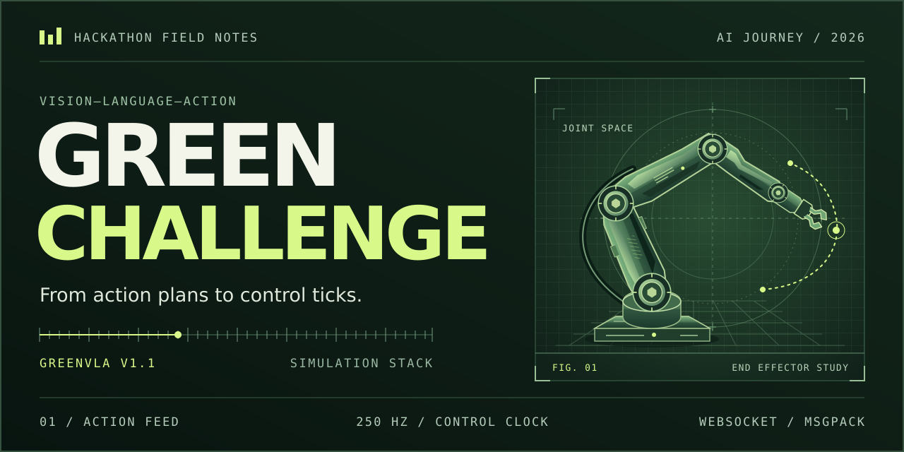

[Русская версия](../../README.md) · [CPU trace and artwork](README.md)



# Green Challenge 2026 — action execution for GreenVLA

A hackathon project for [Green Challenge 2026](https://dsworks.ru/en/champ/aij26-green) at AI Journey. It uses the organisers’ GreenVLAv1.1 checkpoint unchanged. This project builds the layer that turns the model’s **50-row action plans** into **20 control commands every 80 ms** for the humanoid simulator.

## Engineering contribution

- **Action scheduling:** [the feed](../../greenchallenge/feed.py) timestamps and interpolates the model’s predictions, blends overlapping plans by age, and limits velocity and acceleration on selected joints. Expiry keeps old plans from freezing on their last row and pulling the blend back.
- **Protocol and calibration:** [the boundary](../../greenchallenge/boundary.py) exchanges observations and commands over WebSocket/msgpack. It maps between simulator and model layouts, including recovering absolute finger positions when the simulator echoes the last command.
- **Two execution paths:** the default Docker configuration keeps the official stack and changes the interval between model rows. The experimental `boundary` stack moves the feed into this repository so timing changes can be isolated and observed with JSONL telemetry.

## What is verified

A [CPU smoke test](../../tools/smoke_test.py) with a scripted stand-in ran both WebSocket hops, exchanged 38 requests and returned 20 commands per reply. The blend peaked at 15 active plans. [View the recorded trace](README.md) or reproduce it with Python 3.10+:

```bash
git clone --depth 1 https://github.com/overbaffe1/Green-Challenge.git
cd Green-Challenge
python3 -m venv .venv
. .venv/bin/activate
python -m pip install -r requirements-dev.txt
python -m pytest -q
python tools/smoke_test.py --speed 1.3 --seconds 3
```

The CPU check does not run the checkpoint or the GreenSim benchmark. The **15.445 → 18.096** leaderboard comparison that informed the default playback rate comes from [another participant’s published experiment](https://github.com/fanot/miniature-dollop/blob/9365c5b0a6997fe650e8df02c3eaae25ec8243c4/README.md#результаты-на-лидерборде), not this repository. It does not establish completion or score for this project.

[Architecture](../ARCHITECTURE.md) · [Configuration](../CONFIGURATION.md) · [Docker runbook](../RUNBOOK.md) · [Evaluation](../EVALUATION.md)

Upstream: [GreenVLA](https://github.com/greenvla/GreenVLA) and [GreenSim](https://github.com/greenvla/GreenSim).
